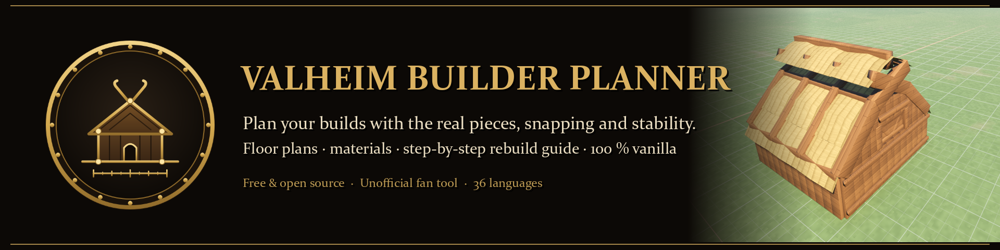
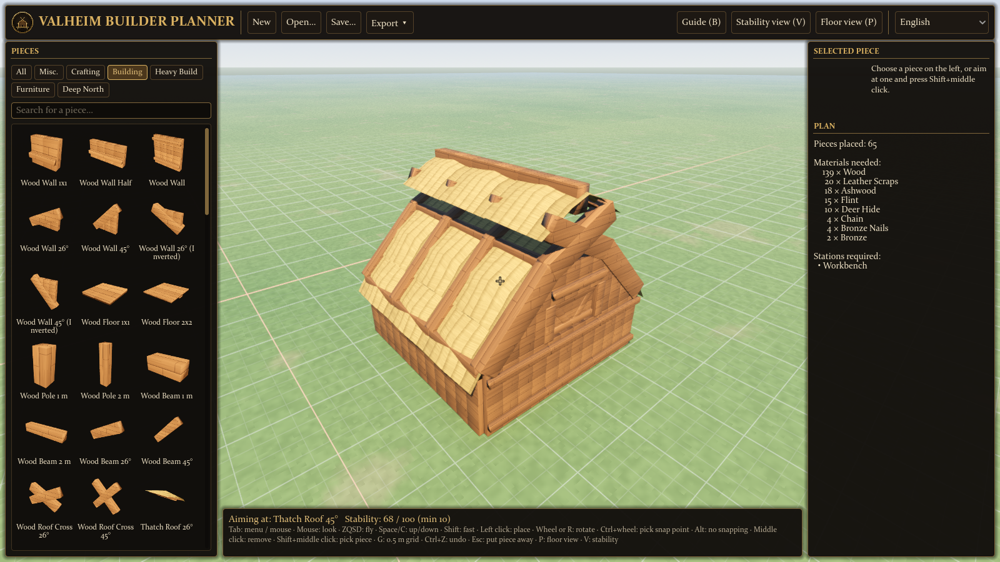
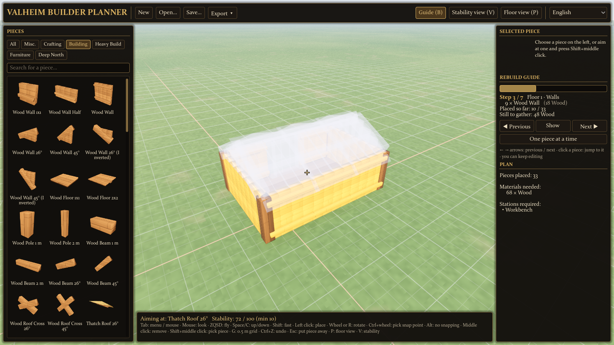
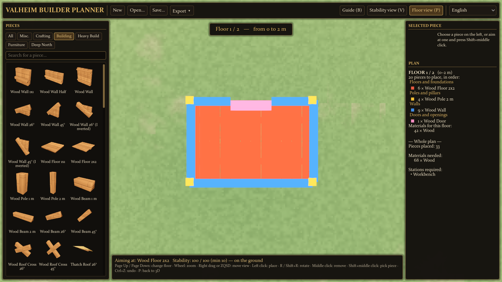
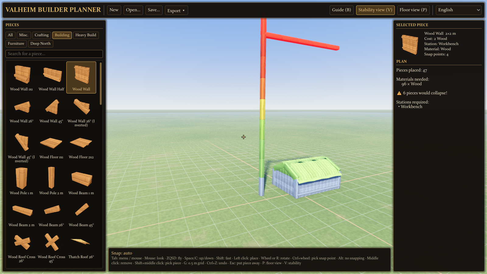
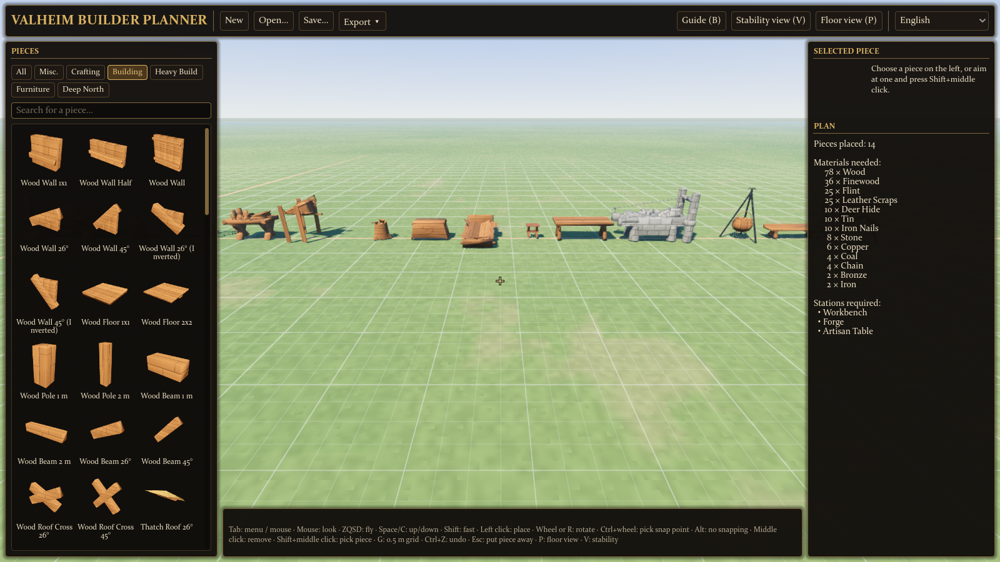

# Valheim Builder Planner

Plan your Valheim builds outside the game, with the game's own pieces, snapping and stability rules, then rebuild them in your world, 100 % vanilla.

> Unofficial fan tool. Not affiliated with Iron Gate or Coffee Stain. **No game files or data are included**: on first launch the planner reads the building pieces from *your own* Valheim installation, on your computer. Your game and saves are only read, never modified.

## Features
- **Every Hammer piece** (≈ 390) with its real shape, size, cost and crafting station, in the 36 languages of the game.
- **Snapping like in the game** (same snap points and rules), rotation in 22.5° steps.
- **Stability** computed with the game's rules (wood, core wood, stone, iron, marble…): see what holds and what would collapse before building.
- **Floor view**, **materials list** per floor, **build list export** (text checklist).
- **Rebuild guide**: step by step, foundations first, roof last, the current step highlighted in 3D.
- Copy/paste, undo, autosave, Valheim-style camera (fly, mouse look).
- **Optional PlanBuild support**: export your plan as a PlanBuild blueprint in one click, or open PlanBuild / BuildShare blueprints from the community. PlanBuild is a mod: while a mod is loaded, Valheim disables achievements.

| | |
|---|---|
|  |  |
|  |  |

## Install
1. Download the latest release from [GitHub Releases](https://github.com/ICCUser/valheim-builder-planner/releases) or Nexus Mods, and unzip it anywhere.
2. Run `ValheimBuilderPlanner.exe` (Windows 64-bit). Valheim must be installed (Steam is found automatically, or choose the folder).
3. First launch reads your game (about a minute). Done.

## Build from source
Godot 4.7 .NET + .NET 8 SDK. Run `run-dev.bat`, or open `app/` in Godot. `tools/Extractor` runs the same game reading from the command line.

## Translations
The interface is in English and French. Help translate it: see [TRANSLATING.md](TRANSLATING.md).

## License
[MIT](LICENSE). Valheim is a trademark of Iron Gate AB.

---

## 🇫🇷 En français
Planifie tes constructions Valheim hors du jeu, avec les vraies pièces, l'accroche et la stabilité du jeu, puis reconstruis-les dans ton monde, en 100 % vanilla. Outil de fan non officiel : **aucun fichier du jeu n'est inclus**, les données sont lues dans ta propre installation au premier lancement. Export PlanBuild optionnel (mod : les succès sont désactivés tant qu'un mod est chargé).
